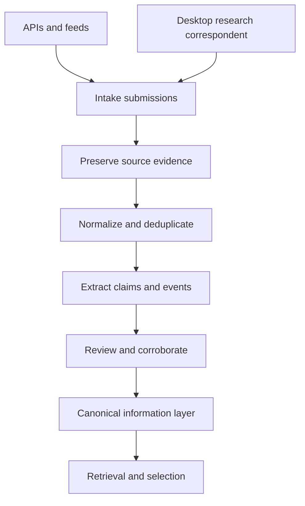
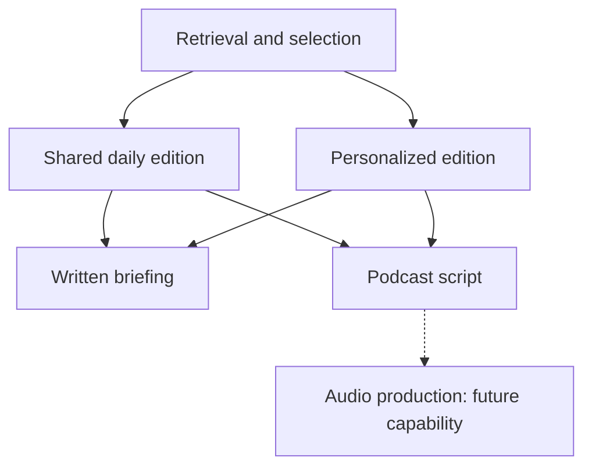

# Proposed architecture

Status: conceptual. No product services are deployed.

## Collection and knowledge pipeline

Both collection paths preserve evidence before transformation and review. Only eligible information feeds edition selection.

The canonical layer retains source records, topic and event history, and relationships. Vector and graph capabilities remain design options.

## Edition production

Shared and personalized editions use the same source-grounded information. Each edition supplies a written brief and a podcast script; audio production remains a future capability.

## Storage responsibilities

Keep source identity, claims, revision history, editorial state, and edition records in canonical structured storage. Embeddings provide semantic similarity; graph relationships connect entities, events, and topics. These could be capabilities of one store or separate derived indexes. Do not select a hybrid database before evaluating retrieval and history queries.

Store original evidence separately from model-generated interpretation. Each claim and edition segment must be traceable to supporting source records. Reindexing embeddings must not rewrite history.

## Processing boundaries

Intake records what was collected and by whom. Transformation proposes structured records. Review determines what is eligible for publication. Edition generation selects eligible material and produces a versioned, sourced artifact. Publishing is a separate permission and operation.

Make imports idempotent using stable source identifiers/content hashes; retain revisions rather than overwriting changed reports. Track pipeline failures and retry state. These are proposed requirements to test in a prototype.

## Open decisions

Database and index design, collection mechanisms, source reuse permissions, editorial gates, provider choice, cost controls, and batch versus streaming processing remain undecided.

See [canonical model](data-model.md), [desktop intake](desktop-correspondent.md), [decisions](decisions/index.md), and [roadmap](roadmap.md).

## Related work

- [Validate canonical records and storage options](https://github.com/kaw393939/awareness-briefing/issues/4)

- [Render documentation diagrams with Mermaid](https://github.com/kaw393939/awareness-briefing/issues/8)
