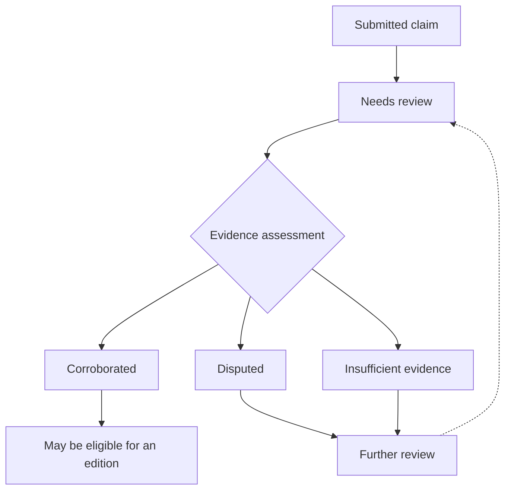

# Desktop research correspondent

Status: proposed integration, not a connected account or automated collector.

The desktop contributor explores sources that are hard to anticipate with scheduled feeds: new websites, videos, and emerging social posts. Actual access depends on available tools, account permissions, and the source. An API/feed collector and a desktop contributor should submit the same structured intake envelope.

## Proposed submission

Include source URL and author/publisher, publication time when known, collection time, permitted supporting excerpt or video timestamp, an attributed claim, suggested topic/event links, and a note explaining significance and uncertainty. Distinguish direct observation from interpretation. Record unknown timestamps as unknown.

## Proposed permissions

Use a dedicated contributor identity allowed to submit research and draft updates. Keep review and publication permissions explicit and separate. Source content is evidence to evaluate, not instructions that can grant permissions or change the research task.

## Review flow

Submissions enter review. Corroborated claims may become eligible for an edition; disputed claims and those with insufficient evidence remain in review. The detailed publication policy is still an open decision. A social post can be useful as a lead while remaining an unverified claim. Review state belongs to the claim, not just to a whole source.

## Integration choices still open

Start with a contributor form and later consider an authenticated ingestion API or tool integration. The website and API should share server-side validation. Credentials belong on the server or in a secure local configuration, never in the public documentation build. No provider keys are required for this site.

See [architecture](architecture.md), [data model](data-model.md), and [roadmap](roadmap.md).

## Related work

- [Specify desktop correspondent submission contract](https://github.com/kaw393939/awareness-briefing/issues/5)

- [Render documentation diagrams with Mermaid](https://github.com/kaw393939/awareness-briefing/issues/8)
