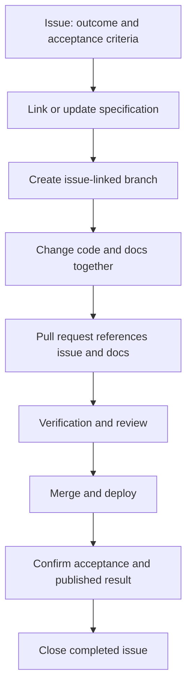

# Working process

## Traceability contract

Every task links its issue, relevant documentation, implementation, and verification evidence. An issue records discussion and acceptance criteria. Markdown records the current specification. A PR records the exact implementation and evidence.

## Issue intake

Use the supplied task, research/decision, or bug form. Link a specific documentation page/heading and source paths, or explicitly say the code is not implemented. Add acceptance criteria and dependencies. Keep tasks small enough to review independently.

Use `type:task`, `type:research`, or `type:bug`, with an area label. Apply exactly one status label: `status:backlog`, `status:ready`, `status:in-progress`, `status:review`, or `status:blocked`. GitHub's open/closed state remains the completion record. Remove the old status label when moving work; label transitions are manual.

[All open work](https://github.com/kaw393939/awareness-briefing/issues?q=is%3Aissue%20is%3Aopen) · [Ready](https://github.com/kaw393939/awareness-briefing/issues?q=is%3Aissue%20is%3Aopen%20label%3Astatus%3Aready) · [In progress](https://github.com/kaw393939/awareness-briefing/issues?q=is%3Aissue%20is%3Aopen%20label%3Astatus%3Ain-progress) · [Blocked](https://github.com/kaw393939/awareness-briefing/issues?q=is%3Aissue%20is%3Aopen%20label%3Astatus%3Ablocked)

## Start work

Assign the issue, change its status, and create `codex/<number>-<description>`. Link the issue in a “Related work” section of the affected document. For decisions, use the [decision template](decisions/template.md) and preserve superseded records.

## Pull requests

Use the PR template. Include an issue reference (`Closes #123` or `Refs #123`), a documentation URL, changed paths, and actual verification results. The PR workflow checks for an issue reference and a documentation URL; reviewers verify the relationship and acceptance criteria. It does not prove that the issue exists or that requirements are satisfied.

`Closes #123` closes a linked issue when the PR merges into the default branch. `Refs #123` keeps partial work open. For future code in another repository use the full `owner/repo#123` reference and reciprocal links. See [GitHub's linking rules](https://docs.github.com/en/issues/tracking-your-work-with-issues/using-issues/linking-a-pull-request-to-an-issue).

## Definition of done

Acceptance criteria are met, affected docs reflect the change, checks pass, a reviewer can follow the evidence, and the PR is merged. For publishing work, confirm the deployed page. Close only completed issues and remove any active status label.

See [roadmap](roadmap.md) and [development](development.md).

## Related work

- [Render documentation diagrams with Mermaid](https://github.com/kaw393939/awareness-briefing/issues/8)
